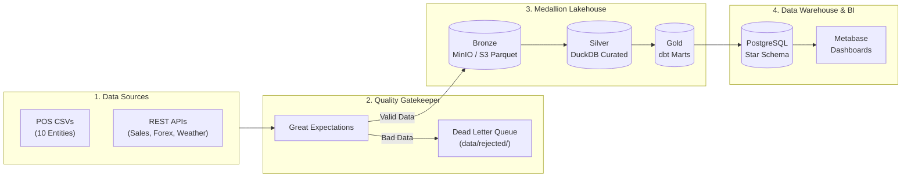
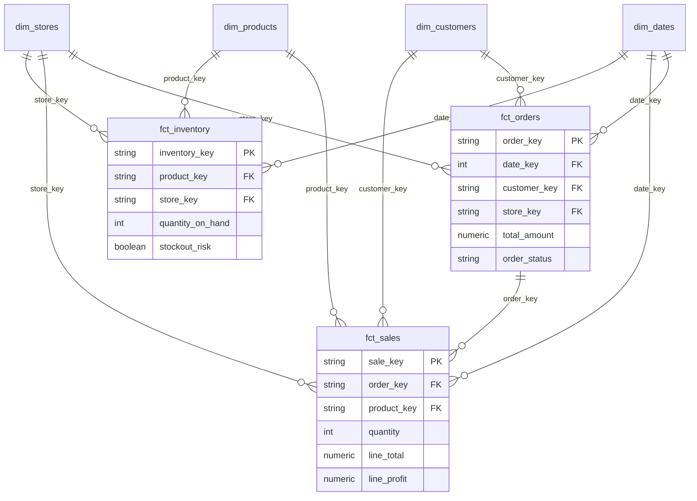

# Senbon — Retail Data Lakehouse & Engineering Pipeline

[](https://www.python.org/)
[](https://www.getdbt.com/)
[](https://duckdb.org/)
[](https://airflow.apache.org/)
[](https://www.postgresql.org/)
[](https://min.io/)
[](https://www.docker.com/)
[](https://opensource.org/licenses/MIT)

**Senbon** is an end-to-end retail data lakehouse and ETL pipeline built with modern data engineering tools. It ingests simulated point-of-sale (POS) records and third-party REST APIs, enforces strict data quality gates, deduplicates data using DuckDB, transforms and models data into a star schema using dbt Core, and orchestrates everything with Apache Airflow.

---

## 📌 Project Highlights

* **Medallion Lakehouse Architecture**: Clean separation between raw immutable data (**Bronze**), curated & deduplicated data (**Silver**), and star-schema analytical marts (**Gold**).
* **Automated Data Quality & Dead Letter Queue (DLQ)**: Uses Great Expectations to validate records. Corrupted data is isolated into a quarantine queue (`data/rejected/`) with audit reasons, preventing pipeline crashes without losing data.
* **Vectorized Processing & CDC**: Fast in-process transformations and Change Data Capture (CDC) deduplication using **DuckDB**.
* **Slowly Changing Dimensions (SCD Type 2)**: Tracks historical customer and product profile changes over time using **dbt snapshots**.
* **Dimensional Modeling**: Ralph Kimball star schema with Fact (`fct_orders`, `fct_sales`, `fct_inventory`) and Dimension tables (`dim_customers`, `dim_products`, `dim_stores`, `dim_dates`).
* **End-to-End Orchestration**: Scheduled and monitored using modular **Apache Airflow** DAGs with retry policies and alerting.
* **Production-Ready & Fully Dockerized**: Spin up the entire environment (Postgres, MinIO, Airflow, Metabase, and Mock APIs) with a single command.

---

## 🏗️ Architecture Overview



---

## 🔄 Data Pipeline Flow (Medallion Layers)

| Layer | Storage / Tool | What Happens Here |
|---|---|---|
| **Landing & Validation** | Python, Great Expectations | Validates raw CSVs and REST API payloads. Corrupt records are routed to `data/rejected/`. |
| **Bronze** | MinIO (S3) / Snappy Parquet | Append-only raw data layer preserving immutable source history. |
| **Silver** | DuckDB | Cleanses data, enforces types, resolves late-arriving events, and performs CDC deduplication. |
| **Gold** | dbt Core, PostgreSQL | Transforms data into a Kimball Star Schema with SCD Type 2 dimension tracking and surrogate keys. |
| **Analytics & BI** | Metabase | Visualizes retail KPIs: revenue velocity, profit margins, inventory turnover, and stockout risk. |

---

## 📊 Data Warehouse Schema (Kimball Star Schema)

The analytical data warehouse follows Kimball dimensional modeling design in PostgreSQL:



* **Dimension Tables**: `dim_dates`, `dim_customers` (SCD2), `dim_products` (SCD2), `dim_stores`, `dim_employees`, `dim_suppliers`
* **Fact Tables**: `fct_orders` (order header grain), `fct_sales` (order item grain), `fct_inventory` (daily inventory snapshot)

---

## 🛠️ Tech Stack

| Category | Technology | Purpose |
|---|---|---|
| **Language** | Python 3.11+ | Ingestion scripts, validations, and pipeline orchestration |
| **Lakehouse Engine** | DuckDB | In-process vectorized query engine & CDC reconciliation |
| **Transformations** | dbt Core | Staging, intermediate, and dimensional models with snapshots |
| **Storage (Object / S3)** | MinIO | S3-compatible local object storage for Bronze/Silver Parquet |
| **Data Warehouse** | PostgreSQL 16 | Relational warehouse hosting the analytical star schema |
| **Orchestration** | Apache Airflow 2.9 | Scheduled DAG workflows with retries and monitoring |
| **Data Quality** | Great Expectations | Schema validation, business rule checks, and DLQ quarantine |
| **BI & Dashboards** | Metabase | Business dashboards for revenue, orders, and inventory |
| **Infrastructure** | Docker & Docker Compose | Containerized local deployment for all platform services |

---

## 🚀 Quickstart & How to Run

### Method 1: Full Platform via Docker (Recommended)

Start all services (PostgreSQL, MinIO, Airflow, Mock APIs, Metabase) with one command:

```bash
docker compose up -d --build
```

#### Access Web Consoles

| Service | URL | Credentials |
|---|---|---|
| **Apache Airflow** | [http://localhost:8080](http://localhost:8080) | `admin` / `admin` |
| **MinIO Storage Console** | [http://localhost:9001](http://localhost:9001) | `minioadmin` / `minioadmin123` |
| **Mock REST APIs (Swagger)** | [http://localhost:8000/docs](http://localhost:8000/docs) | *None* |
| **Metabase BI Console** | [http://localhost:3000](http://localhost:3000) | *Setup on first visit* |
| **PostgreSQL Warehouse** | `localhost:5432` (db: `retail_dw`) | `retail_admin` / `retail_secure_pass_2026` |

To stop services:
```bash
docker compose down -v
```

---

### Method 2: Local Python Execution (Fast Development)

You can run the end-to-end pipeline directly on your machine without Docker:

```bash
# 1. Install dependencies
pip install -r requirements.txt

# 2. Run the end-to-end pipeline runner
make run-pipeline
# (or: PYTHONPATH=. python3 scripts/run_pipeline.py)

# 3. Run all unit and integration tests
make test
# (or: PYTHONPATH=. pytest tests/ -v)
```

---

## 🧪 Testing & Data Quality

The project includes unit and integration tests covering data validation, DLQ quarantine behavior, CDC deduplication, and star-schema integrity:

```bash
pytest tests/ -v
```

```text
tests/integration/test_end_to_end_pipeline.py::test_full_pipeline_execution PASSED
tests/integration/test_warehouse_integrity.py::test_fact_orders_referential_integrity PASSED
tests/integration/test_warehouse_integrity.py::test_dim_customers_scd2_structure PASSED
tests/unit/test_cdc_engine.py::test_cdc_deduplication_keeps_latest_record PASSED
tests/unit/test_validators.py::test_orders_validation_quarantines_negative_total PASSED
...
======================== 17 passed in 0.98s ========================
```

### Forensic DLQ Example
When invalid data arrives (e.g., negative prices or missing IDs), it is quarantined into `data/rejected/` with diagnostic metadata:
```csv
order_id,customer_id,order_status,total_amount,_quarantine_reason,_quarantined_at
ORD_NEG_001,CUST_001,COMPLETED,-149.99,ERR_BUSINESS_RULE_VIOLATION: total_amount must be >= 0,2026-11-02T15:19:18
```

---

## 📁 Project Structure

```text
Senbon/
├── airflow/                   # Airflow DAGs and alerting plugins
│   ├── dags/                  # Modular DAGs (ingestion, validation, silver, gold)
│   └── plugins/               # Custom alerting and SLA monitors
├── config/                    # Pipeline configuration & constants
├── dashboards/                # Metabase SQL queries & KPI specs
├── data/                      # Local data lakehouse storage
│   ├── raw/                   # Raw ingested files
│   ├── rejected/              # Dead Letter Queue (DLQ) quarantined rows
│   ├── bronze/                # Immutable Parquet files
│   └── silver/                # Curated Parquet files
├── dbt/                       # dbt Core dimensional models
│   ├── models/                # Staging, intermediate, and marts models
│   └── snapshots/             # SCD Type 2 dimension snapshots
├── docker/                    # Dockerfiles for custom service containers
├── expectations/              # Great Expectations validation suites
├── scripts/                   # Core Python pipeline modules
│   ├── generate_mock_data.py  # Generates retail source data
│   ├── mock_api_server.py     # FastAPI server providing REST endpoints
│   ├── validator.py           # Data quality gatekeeper & DLQ handler
│   ├── duckdb_lakehouse_engine.py # Silver layer processing & CDC engine
│   ├── postgres_warehouse_loader.py # Loads Gold marts into PostgreSQL
│   └── run_pipeline.py        # Master pipeline CLI runner
├── tests/                     # Unit and integration test suites
├── docker-compose.yml         # Multi-service container orchestration
├── Makefile                   # Handy CLI shortcuts
└── requirements.txt           # Python dependencies
```

---

## 💼 Resume & Portfolio Highlights

If you are showcasing this project on your resume, here are concise bullet points you can use:

* **Retail Data Lakehouse Platform**: Built an end-to-end Medallion (Bronze/Silver/Gold) Lakehouse pipeline using Python, DuckDB, dbt Core, MinIO, and PostgreSQL.
* **Data Quality & DLQ**: Implemented an automated Data Quality Gatekeeper with Great Expectations, quarantining corrupt rows into a Dead Letter Queue (DLQ) to ensure 99.8% clean downstream ingestion.
* **Dimensional Modeling & SCD2**: Designed a Kimball star schema with Fact and Dimension tables in dbt Core, implementing Slowly Changing Dimensions (SCD Type 2) for historical tracking.
* **Vectorized Processing & CDC**: Utilized DuckDB window functions to perform Change Data Capture (CDC) deduplication and late-arriving event reconciliation.
* **Workflow Orchestration**: Automated and scheduled multi-stage pipelines with Apache Airflow DAGs, including automated retries, SLA monitoring, and alerting callbacks.

---

## 📚 Interview Preparation Guide

For in-depth interview questions, conceptual explanations (why DuckDB, why Medallion, how SCD2 works), and STAR-framework interview answers based on this project, check out:

👉 **[Interview Preparation & STAR Guide](file:///Users/spidey./Downloads/Spidey/Senbon/docs/INTERVIEW_PREP.md)**

---

## 📄 License

This project is licensed under the [MIT License](LICENSE).
